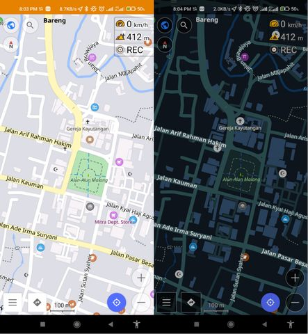

# phmap-osmand

OsmAnd custom rendering style and routing. Currently, we have two styles variant available at the moment and one custom routing for car.



# Rendering Style Installation

**Easy way**

Open OsmAnd, go to **Settings**, scroll to bottom, tap **Import from file** then select the **pranatahouse-osmand-rendering-style.osf** file that you just downloaded from our release.

or

Open command prompt on Windows and run the file **install-wuzz.bat** or **install-wuzz.sh** if you are using Linux.

**Manual**

1. Put the *.render.xml file from the **styles/** folder in **/storage/emulated/0/Android/data/net.osmand.plus/files/rendering/** for OsmAnd plus or **/storage/emulated/0/Android/data/net.osmand/files/rendering/** for OsmAnd App.
2. Open OsmAnd app and select **Configure Map > Map rendering > Map style** than select **Pranatahouse** or **Phmaps**.

# Build the .osf package

The importable **.osf** bundle is built from the rendering styles in **styles/**:

```sh
./build-osf.sh                              # -> OsmAnd-Custom-Map-Styles.osf
./build-osf.sh OUTPUT.osf                   # choose another output name
./build-osf.sh OUTPUT.osf wuzz.render.xml   # only the listed styles
```

By default it packages **pranatahouse.render.xml** and **wuzz.render.xml**. Only **zip** is required.

# Release

Releases are published by the **Release rendering styles (.osf)** GitHub Actions workflow
(**Actions > Release rendering styles (.osf) > Run workflow**). It runs **on demand only** -
it never triggers automatically on push.

| Input | Description |
| --- | --- |
| **version** | Version to release, e.g. `1.1`. Leave empty to bump the latest release automatically. |
| **dry_run** | Build the .osf only, without creating the release. |

The workflow builds the .osf, creates the version tag, publishes the
**pranatahouse-osmand-rendering-style.osf** asset as a GitHub release and updates the
**VERSION** file in the repository.

# Custom Routing Installation

1. Put the routing.xml file in **/storage/emulated/0/Android/data/net.osmand.plus/files/routing/** for OsmAnd plus or **/storage/emulated/0/Android/data/net.osmand/files/routing/** for OsmAnd App.
2. Open OsmAnd app and select **Driving Profile > Configure profile > navigation settings > Navigation type > Offline > routing.xml** than select **phcar**.
